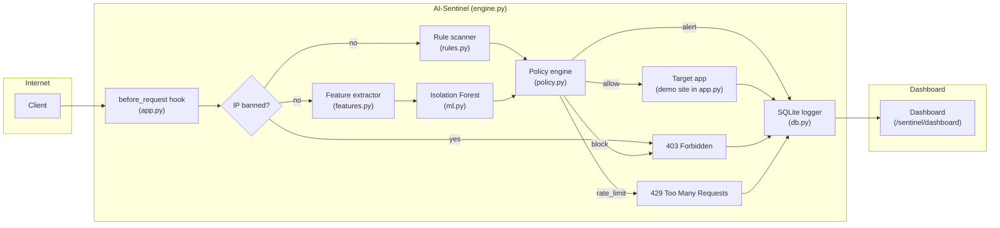

# Architecture — AI-Sentinel

> This document maps the paper's architecture (sections 3 and 5) to the
> actual modules in the repository. It is written during Phase 0 and will
> be kept up to date as the code evolves.

## High-level pipeline

## Module table

| Module | File | Paper section | Purpose | Lines |
|---|---|---|---|---|
| Flask app + guard | `sentinel/app.py` | 5.1 (WAF integration) | `before_request` hook intercepts every request (paths, queries, POST bodies, cookies, referer, auth headers) and calls engine. Response security headers (CSP, X-Frame-Options, X-Content-Type-Options). Dashboard, CSV export, `/sentinel/health`, and `/sentinel/api/*`. | 510+ |
| Rule scanner | `sentinel/rules.py` | 5.1 (Signature rules) | 25+ regex patterns for SQLi, XSS, path traversal, command injection, scanner UA, null bytes, SSRF, Log4Shell, XXE, open redirect, response splitting. | 120+ |
| Feature extractor | `sentinel/features.py` | 5.3 (Feature engineering) | Converts a request into a 12-dimensional numeric vector for the ML model. | 61 |
| ML detector | `sentinel/ml.py` | 5.3 (Anomaly detection) | Trains and scores with scikit-learn `IsolationForest`. Trained on synthetic normal traffic. | 58 |
| Normal traffic gen | `sentinel/normal_traffic.py` | 5.3 (Training data) | Generates synthetic "normal" requests for ML training. | 70 |
| Policy engine | `sentinel/policy.py` | 5.5 (Active defence) | Priority cascade: brute-force → high-rule → rule+ML → rate-limit → low-rule → ML-only → allow. ML alone never blocks. | 34 |
| Pipeline orchestrator | `sentinel/engine.py` | 5.5 (Decision engine) | Wires together ban check → rules → features → ML → policy. Tracks per-IP state, persists bans to SQLite across server restarts, and supports manual unban. | 145+ |
| Database / logger | `sentinel/db.py` | 5.4 (Logging) | SQLite event log + persistent bans table. Parameterised queries. Masks passwords. Generates request IDs. | 135+ |
| Configuration | `sentinel/config.py` | — | All thresholds, paths, feature flags, API key, webhook URL in one file. Env var overrides. | 38 |
| Evaluator | `evaluate.py` | 8 (Evaluation) | Runs rules-only vs rules+ML on a built-in attack list + synthetic normal traffic. Reports precision, recall, FPR, latency. | 200 |
| Demo script | `demo.py` | — | Sends normal + attack + brute-force traffic to localhost for live demo. | 65 |
| Tests | `tests/test_basic.py` | — | 30 unittest tests covering attacks, brute force, rate limit, logging, headers, unban, persistent bans, health check, and CSV export. | 260+ |
| Entry point | `run.py` | — | `python run.py` starts Flask on 127.0.0.1:5000. | 7 |

## What is missing vs the paper

See the "Gaps" section in the Phase 0 plan.
